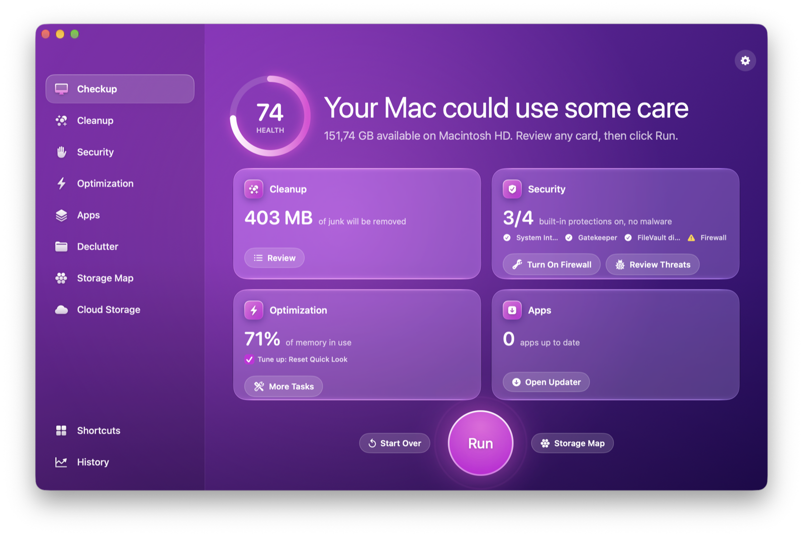
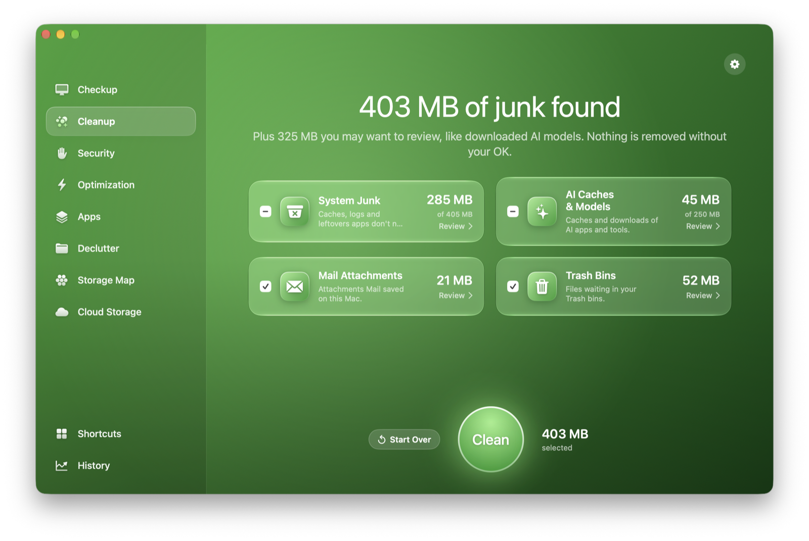
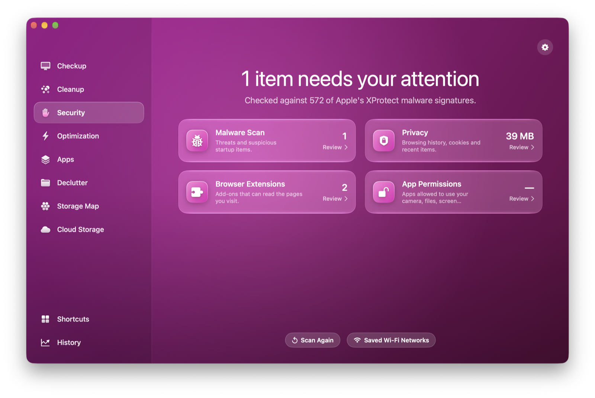
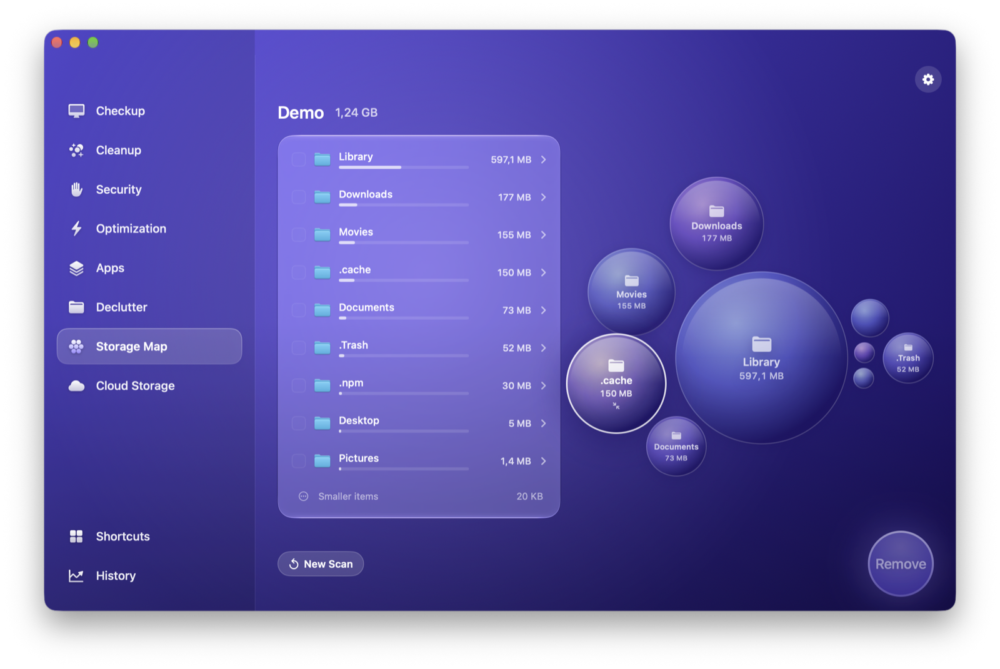
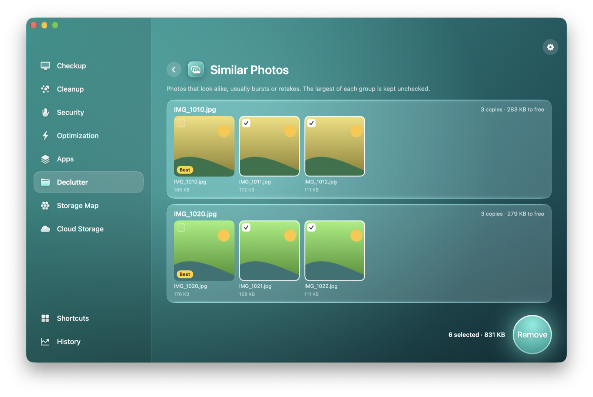
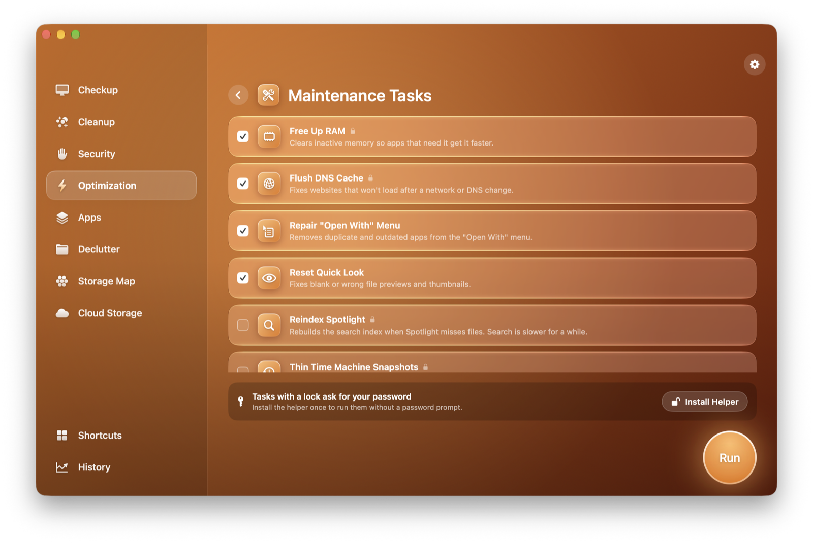
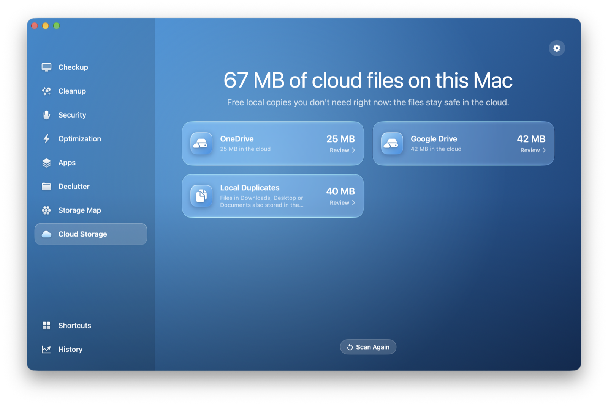
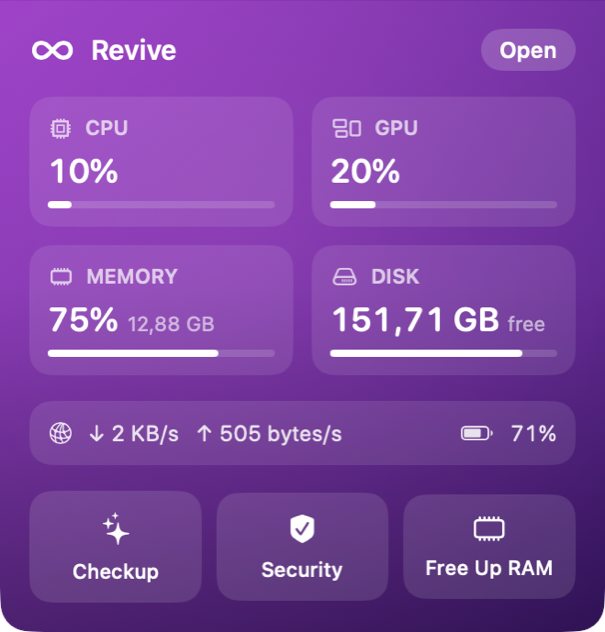

<p align="center">
  
</p>

<h1 align="center">Revive</h1>

<p align="center">
  <strong>Redonnez vie à votre Mac.</strong><br>
  Un nettoyeur, optimiseur et antimalware pour Mac, gratuit et open source, développé nativement en SwiftUI.
</p>

<p align="center">
  <a href="README.md">English</a> · <strong>Français</strong>
</p>

<p align="center">
  <a href="https://github.com/mbielle/revive/releases/latest"></a>
  <a href="https://github.com/mbielle/revive/actions/workflows/ci.yml"></a>
  
  
  
  
  <a href="LICENSE"></a>
  
</p>

<p align="center">
  
</p>

<p align="center">
  <a href="https://github.com/mbielle/revive/releases/latest"></a>
</p>

<p align="center">
  <sub>Gratuit pour toujours · Sans compte · Sans abonnement · Vos fichiers ne quittent jamais votre Mac</sub>
</p>

---

## Pourquoi Revive ?

Garder un Mac propre, sûr et rapide est utile à tout le monde : l’outil pour le faire devrait donc être gratuit pour tout le monde.

- 🆓 **Gratuit et open source.** Pas d’abonnement, pas de version « Pro », pas de fenêtres insistantes. Tout le code est ici, sous licence GPL-3.0.
- 🔒 **Respect de la vie privée.** Aucune statistique, aucun compte, aucun serveur. Les seules requêtes réseau sont les vérifications de mises à jour que vous lancez vous-même.
- 🛡️ **La sécurité d’abord.** Chaque analyse se termine par un écran de vérification, tout passe par la Corbeille, et un garde de sécurité recontrôle chaque élément juste avant d’y toucher.
- 🍎 **Vraiment natif.** SwiftUI, Swift 6, les frameworks d’Apple (Vision, Security, ServiceManagement). Liquid Glass sur macOS 26.
- 🧠 **Il s’appuie sur ce que votre Mac sait déjà.** La détection des malwares utilise les signatures XProtect d’Apple, déjà installées et mises à jour par macOS.

---

## Les fonctionnalités en un coup d’œil

<table>
<tr>
<td width="33%" valign="top">

### 💜 Bilan
Une seule analyse pour les fichiers inutiles, la sécurité, la vitesse et les mises à jour, un score de santé et un bouton **Lancer** pour tout régler.

</td>
<td width="33%" valign="top">

### 🧹 Nettoyage
Fichiers système inutiles, caches et modèles d’IA, pièces jointes Mail et corbeilles, avec plus de 30 règles déclaratives.

</td>
<td width="33%" valign="top">

### 🛡️ Sécurité
Recherche de malwares avec les règles YARA XProtect d’Apple, éléments de démarrage à risque, confidentialité des navigateurs, extensions, Wi-Fi, autorisations des apps.

</td>
</tr>
<tr>
<td width="33%" valign="top">

### ⚡ Optimisation
Scripts de maintenance, éléments d’ouverture et en arrière-plan, gros consommateurs de CPU et de mémoire en direct.

</td>
<td width="33%" valign="top">

### 📦 Apps
Désinstallation complète, réinitialisation, restes d’apps supprimées, installeurs, mises à jour via Sparkle, l’App Store et Homebrew.

</td>
<td width="33%" valign="top">

### 🗂️ Désencombrer
Doublons, photos similaires (Vision, sur l’appareil), gros fichiers anciens, captures d’écran.

</td>
</tr>
<tr>
<td width="33%" valign="top">

### 🫧 Carte du stockage
Une carte en bulles animée de n’importe quel dossier ou du disque entier. Survolez pour lire, cliquez pour zoomer.

</td>
<td width="33%" valign="top">

### ☁️ Stockage cloud
iCloud Drive, Google Drive, OneDrive, Dropbox : libérez les copies locales sans rien supprimer du cloud.

</td>
<td width="33%" valign="top">

### ♾️ Barre des menus
CPU, GPU, mémoire, disque, réseau et batterie en un coup d’œil, plus Bilan, analyse de sécurité et libération de la RAM en un clic.

</td>
</tr>
</table>

---

## Visite rapide

<table>
<tr>
<td width="50%" align="center">
<br>
<b>Nettoyage</b> : ce qui a été trouvé, par catégorie. Vérifiez chaque élément avant suppression.
</td>
<td width="50%" align="center">
<br>
<b>Sécurité</b> : signatures de malwares d’Apple, éléments de démarrage, traces de navigation et autorisations.
</td>
</tr>
<tr>
<td width="50%" align="center">
<br>
<b>Carte du stockage</b> : les bulles grossissent au survol et zooment au clic.
</td>
<td width="50%" align="center">
<br>
<b>Désencombrer</b> : les photos qui se ressemblent, regroupées par Vision d’Apple, la meilleure est gardée.
</td>
</tr>
<tr>
<td width="50%" align="center">
<br>
<b>Optimisation</b> : des scripts de maintenance éprouvés, un seul mot de passe au maximum.
</td>
<td width="50%" align="center">
<br>
<b>Stockage cloud</b> : voyez ce que vos dossiers cloud gardent sur le disque et libérez-le.
</td>
</tr>
</table>

<table>
<tr>
<td width="40%" align="center">

</td>
<td width="60%" valign="middle">

### ♾️ Toujours à portée de clic

Cliquez sur l’icône infini de la barre des menus pour voir l’état de votre Mac en direct :

- **Charge CPU et GPU**, mesurée auprès du noyau et du pilote graphique
- **Mémoire utilisée**, avec la même définition que le Moniteur d’activité
- **Espace disque, débit réseau et batterie**
- **Actions rapides** : lancer un Bilan, une analyse de sécurité ou libérer la RAM sans ouvrir la fenêtre principale

</td>
</tr>
</table>

---

## La sécurité avant tout

Un nettoyeur touche à vos fichiers : Revive est prudent à chaque étape.

| Garde-fou | Ce que ça signifie pour vous |
|---|---|
| **Vérification avant suppression** | Chaque analyse se termine par un récapitulatif détaillé. Rien n’est supprimé en silence. |
| **Corbeille d’abord** | Les éléments vont à la Corbeille et peuvent être restaurés. Seul ce qui est déjà dans une corbeille est supprimé définitivement, quand vous la videz. |
| **Garde de sécurité** | Chaque élément est recontrôlé juste avant d’y toucher. Les emplacements système, trousseaux, dossiers iCloud et cloud, bases Mail et Messages, apps et données d’Apple, et caches que macOS ne sait pas recréer sont toujours refusés. Les liens symboliques sont résolus avant. |
| **Apps ouvertes respectées** | Les caches des apps ouvertes restent décochés ; les apps sont quittées avant d’être désinstallées. |
| **Désinstallation stricte** | Seuls les fichiers nommés exactement d’après l’identifiant ou le nom de l’app sont proposés. |
| **Mode simulation** | Tout fonctionne sans rien modifier (Réglages). |
| **Exclusions** | Les dossiers que vous indiquez ne sont jamais analysés ni touchés. |
| **Outil d’aide fermé** | Les tâches administrateur viennent d’une liste fixe de commandes, uniquement pour une app Revive signée par la même équipe. |

---

## Revive face aux autres

|  | **Revive** | CleanMyMac | Mac Sai | PureMac | Pearcleaner |
|---|:---:|:---:|:---:|:---:|:---:|
| **Prix** | Gratuit | Abonnement | Gratuit | Gratuit | Gratuit |
| **Licence** | ✅ GPL-3.0 | ❌ Fermée | ✅ BSD-3 | ✅ MIT | ➖ Code visible |
| **Bilan en un clic** | ✅ | ✅ | ✅ | ➖ | ❌ |
| **Fichiers système inutiles** | ✅ | ✅ | ✅ | ✅ | ➖ |
| **Caches et modèles d’IA** | ✅ | ✅ | ✅ | – | – |
| **Malwares avec les règles YARA XProtect d’Apple** | ✅ Règles complètes | ➖ Moteur maison | ➖ Empreintes seulement | ❌ | ❌ |
| **Confidentialité et extensions des navigateurs** | ✅ | ✅ | ✅ | ❌ | ❌ |
| **Désinstallation avec les restes** | ✅ | ✅ | ✅ | ✅ | ✅ |
| **Mises à jour des apps** (Sparkle, App Store, Homebrew) | ✅ | ✅ | ➖ Sparkle | ➖ Homebrew | ✅ |
| **Doublons et photos similaires** | ✅ | ✅ | ➖ Doublons | ✅ | ❌ |
| **Carte visuelle du disque** | ✅ Bulles | ✅ Bulles | ✅ Treemap | ✅ | ❌ |
| **Copies locales du cloud** | ✅ | ✅ | – | – | – |
| **Moniteur dans la barre des menus** | ✅ | ✅ | ✅ | – | ❌ |
| **Scripts de maintenance** | ✅ | ✅ | ✅ | – | ❌ |
| **Signé et notarisé par Apple** | ⏳ Prévu | ✅ | ✅ | ✅ | ✅ |
| **Langues** | EN, FR | Nombreuses | 7 | 11 | – |

<sub>✅ oui · ➖ partiel · ❌ non · – non documenté. D’après la documentation publique de chaque projet en octobre 2026. Une info dépassée ? Ouvrez une issue.</sub>

> CleanMyMac est un produit soigné et un très bon choix si vous voulez une app payante avec support. Revive s’adresse à celles et ceux qui préfèrent un code lisible et pas d’abonnement. Revive est un projet indépendant, sans lien avec MacPaw.

---

## Installer

1. Téléchargez **[le dernier DMG](https://github.com/mbielle/revive/releases/latest)**, ouvrez-le et glissez **Revive** dans **Applications**.
2. **Premier lancement :** Revive n’est pas encore signé avec un Developer ID d’Apple, donc macOS le bloque la première fois. Ouvrez-le une fois, puis allez dans **Réglages Système › Confidentialité et sécurité** et cliquez sur **Ouvrir quand même**. C’est à faire une seule fois.
3. Donnez à Revive l’**accès complet au disque** quand il le demande : sans lui, macOS cache Mail, Safari, la Corbeille et les données des apps.

Tant que les versions ne sont pas signées, les tâches avec un cadenas demandent votre mot de passe administrateur.

**Configuration :** macOS 14 Sonoma ou plus récent, Apple silicon ou Intel.

---

## Sous le capot

| Besoin | Comment Revive s’y prend |
|---|---|
| **Signatures de malwares** | Apple installe ses règles YARA XProtect sur chaque Mac. Revive les compile avec [YARA](https://github.com/VirusTotal/yara) 4.5.4 intégré (hachage CommonCrypto, sans OpenSSL) et analyse les programmes de démarrage, les apps, Téléchargements et le Bureau ; l’analyse approfondie couvre plus de dossiers. |
| **Contrôle de persistance** | Les agents et daemons sont inspectés à la manière de KnockKnock (Objective-See) : les programmes non signés ou cachés dans des dossiers temporaires sont signalés. |
| **Règles de nettoyage** | De simples fichiers JSON. Ajouter une règle ne demande aucun code Swift, et les tests vérifient chaque règle avec le garde de sécurité. |
| **Photos similaires** | Empreintes Vision d’Apple, comparées entre photos voisines, sur l’appareil. |
| **Tâches administrateur** | Un outil d’aide privilégié (daemon SMAppService, XPC) qui exécute une liste fermée de commandes. Sans lui, macOS demande le mot de passe. |
| **Mesures** | `host_processor_info`, `vm_statistics64`, statistiques IOKit du GPU et sources d’alimentation. |

---

## Compiler

```bash
brew install xcodegen
git clone https://github.com/mbielle/revive.git
cd revive
xcodegen generate
open Revive.xcodeproj
```

Appuyez sur ⌘R. Lancez les tests du moteur avec `cd Packages/ReviveKit && swift test`, et créez un DMG avec `scripts/make-dmg.sh`.

<details>
<summary><b>Tester sur des données fictives</b></summary>
<br>

```bash
swift scripts/make-demo-home.swift /tmp/ReviveDemo
open build/DerivedData/Build/Products/Debug/Revive.app --args -home /tmp/ReviveDemo -dryRun YES
```

Les versions de debug analysent alors un dossier généré, rempli de fichiers inutiles, de doublons, de photos similaires, d’un faux cloud et d’un élément de démarrage suspect, au lieu de votre dossier personnel.

</details>

<details>
<summary><b>Organisation du projet</b></summary>
<br>

```
App/                      SwiftUI app: design system, one folder per module, menu bar, settings
Helper/                   Privileged helper (launch daemon) and its launchd plist
Packages/ReviveKit/       Engine, testable without UI
  Sources/ReviveKit/      SafetyGuard, rules, scanners, removal, helper XPC, metrics
  Sources/CYara/          Vendored libyara (BSD-3-Clause)
  Tests/                  Swift Testing suite on throwaway fake home folders
Config/                   Signing settings (ad-hoc by default)
scripts/                  Demo home generator, DMG packaging
project.yml               XcodeGen spec (the .xcodeproj is generated)
```

</details>

<details>
<summary><b>Ajouter une règle de nettoyage</b></summary>
<br>

Les règles sont dans `Packages/ReviveKit/Sources/ReviveKit/Resources/Rules/`:

```json
{
  "id": "my-app-cache",
  "category": "systemJunk",
  "symbol": "archivebox",
  "title": { "en": "My App Cache", "fr": "Cache de My App" },
  "detail": { "en": "What it is and why it is safe to remove.", "fr": "…" },
  "paths": ["~/Library/Application Support/MyApp/Cache"],
  "appBundleIDs": ["com.example.myapp"],
  "selectedByDefault": true
}
```

Lancez ensuite `swift test` dans `Packages/ReviveKit`.

</details>

---

## Contribuer

Les contributions sont les bienvenues, surtout les règles de nettoyage et les traductions. Voir [CONTRIBUTING.md](CONTRIBUTING.md).

## Licence

Revive est un logiciel libre sous [licence GNU GPL v3.0](LICENSE). Les projets open source sur lesquels il s’appuie sont crédités dans [THIRD_PARTY_NOTICES.md](THIRD_PARTY_NOTICES.md).

<p align="center">
  <sub>Fait en France par <a href="https://github.com/mbielle">Mathieu Bielle</a>.</sub>
</p>
